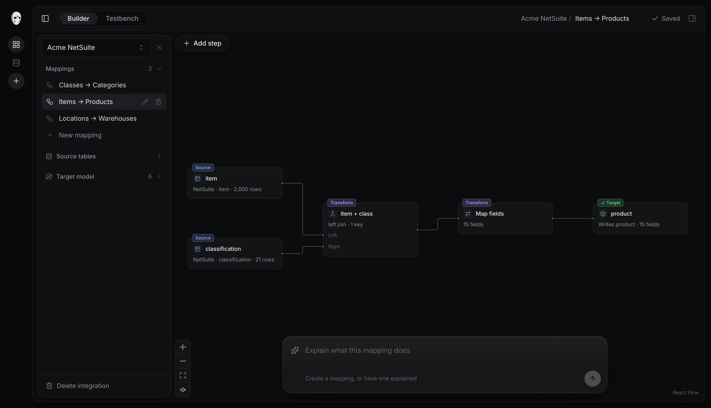

<p align="center">
  <picture>
    <source media="(prefers-color-scheme: dark)" srcset="docs/assets/hockeymask-white.svg" />
    
  </picture>
</p>

<h1 align="center">Hockeymask</h1>

<p align="center"><strong>Different schemas. Same story.</strong></p>
<p align="center">A TypeScript toolkit for mapping connected data models through typed transformation graphs.</p>

<p align="center">
  <a href="#quick-start">Quick start</a> ·
  <a href="arch.md">Architecture</a> ·
  <a href="docs/operators.md">Operators</a> ·
  <a href="docs/development.md">Development</a> ·
  <a href="apps/landing/README.md">Website</a>
</p>

<p align="center">
  
</p>

---

Schema in. A graph of transformations. Your schema out.

- **Connect whole models.** Join, filter, and aggregate related collections.
- **Transform each field.** Compose explicit pipelines for extraction, cleanup, and unit conversion.
- **Check the mapping.** Validate types, structure, expectations, and fixtures before execution.
- **Build visually or in code.** Use the React graph builder or work with versioned JSON.

| Package                               | Purpose                                                               |
| ------------------------------------- | --------------------------------------------------------------------- |
| [`@hockeymask/core`](packages/core)   | Schema types, the connector contract, mapping compiler, and executor. |
| [`@hockeymask/react`](packages/react) | A visual graph builder built on core.                                 |

**In development.** The mapping engine and graph builder work end to end. Auto-fill and source-contract validation are next.

## Quick start

Requires **Node.js 22.18+** and **pnpm 10**.

```sh
pnpm install
pnpm dev
```

Open [localhost:5173](http://localhost:5173) for the demo. Sample data is generated automatically on first start.

```sh
pnpm test     # Run the test suite
pnpm check    # Format, lint, and type-check
pnpm build    # Build the workspace
```

See the [development guide](docs/development.md) for the repository layout and implementation details.
