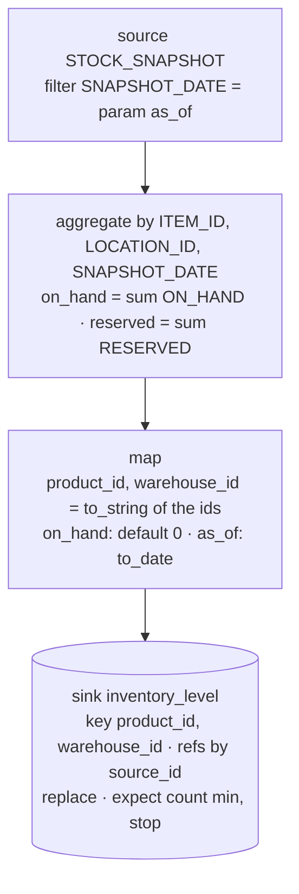

# Operators reference

Every operator a mapping can use, with its params and behaviour. The design behind them is
in [`arch.md`](../arch.md); this page is the reference for what the engine in
[`packages/core/src/mapping`](../packages/core/src/mapping) implements.

## How a mapping works

A mapping is a versioned JSON document: a graph of **collection nodes** that move whole
relations, plus **record ops** that run per field inside a `map`. Every node is a flat object
`{ id, op, label?, ...params }` and names its inputs by id (`in`, `left`/`right` for a join,
`inputs` for a union). There is no edge list.

The usual chain is `source → map → sink`, with `filter`, `join`, `aggregate`, `distinct` and
`union` in between. A `map` field is a pipeline such as
`[{ "op": "extract", "path": "upccode" }, { "op": "blank_to_null" }]`.

What is checked when a draft is saved:

1. Structure: ids are unique, every input points at a node with an output, there are no
   cycles, and every node reaches a `sink`, `metrics` or `assert`.
2. Types: source types come from the source's JSON Schema (`expectedSchema`); every node
   computes its output record type from its inputs. Nullability is part of the type.
3. Targets: each sink field must exist in the target model with a compatible type; one sink
   per target entity.
4. Fixtures (`examples`) run against the graph.

How a run executes: every source is read once into a frozen snapshot, nodes run in
topological order, and sinks return rows for the host instead of writing. A failed node skips
only what depends on it; `skip_downstream` holds back the sinks below a node; `stop` holds
back every sink, but `metrics` still report.

| Type                  | Written                       | Example                         |
| --------------------- | ----------------------------- | ------------------------------- |
| Text, number, boolean | `string`, `number`, `boolean` | `"AO-TENT-2P"`, `1.5`, `true`   |
| Date                  | `date`                        | an instant, from `to_date`      |
| Nullable              | `T?`                          | `number?` may be null           |
| List                  | `list<T>`                     | from `split`, `collect_set`     |
| Tuple                 | `(a, b)`                      | from `extract { path: [a, b] }` |
| Unknown               | `unknown`                     | an untyped reference field      |

## Collection nodes

Eleven nodes move whole relations; three of them (`sink`, `metrics`, `assert`) are the ends
every node must reach.

| Node        | Params                                                                       | In → out                 | What it does                                                                                                                                       |
| ----------- | ---------------------------------------------------------------------------- | ------------------------ | -------------------------------------------------------------------------------------------------------------------------------------------------- |
| `source`    | `system`, `entity`, `filter?`                                                | nothing → rows           | Reads one table of a connected system once per run. Its row type comes from the version's `expectedSchema`; a value that breaks it fails the node. |
| `map`       | `in`, `fields: [{ key, pipeline }]`, `keep?`, `drop?`, `on_error?`           | rows → rows              | One output field per pipeline, run on each row. `keep: "all"` passes the input fields through too.                                                 |
| `filter`    | `in`, `cond`                                                                 | rows → rows              | Keeps rows where the predicate holds. `{ path, is_null: false }` makes that field non-null in the output type.                                     |
| `join`      | `left`, `right`, `on: [[l, r]]`, `type?`, `cardinality`, `select?`, `where?` | two inputs → rows        | Equi-join on key pairs plus an optional residual `where`. Null keys never match. See [Joins and aggregates](#joins-and-aggregates).                |
| `aggregate` | `in`, `group_by`, `fields: { name: agg }`                                    | rows → one row per group | Counts, sums, sets and other aggregates per group; `group_by: []` gives one row overall.                                                           |
| `distinct`  | `in`, `keys`                                                                 | rows → rows              | One row per distinct key combination, projected to the keys.                                                                                       |
| `union`     | `inputs` (2+)                                                                | rows → rows              | Set union of inputs with the same field names; types must agree up to nullability. Duplicates collapse.                                            |
| `sink`      | `in`, `target`, `key`, `columns?`, `write?`, `refs?`, `mode?`                | rows → write             | Upserts into a target entity on `key`, or replaces its rows (`mode`). Each field lands on the target path it names.                                |
| `metrics`   | `in`, `name`, `count_by?`                                                    | rows → run record        | Reports a small relation on the sync run, never into the domain, also when the run stops.                                                          |
| `assert`    | `in`, `check`, check params, `on_fail?`                                      | rows → same rows         | A built-in check (`count`, `unique`, `rows`, `acyclic`) that passes its input through.                                                             |
| `transform` | `ref`, `inputs`, `schema`                                                    | rows → rows              | Escape hatch: reviewed, version-pinned code with a declared output schema.                                                                         |

**`map` on_error.** A field that fails (only fallible ops can) applies `on_error`:
`skip_record` (default) drops the row, `null` writes null, `skip_field` leaves the field out
of the write, `fail_sync` stops the run. A `map` that can drop rows forces the next `join` or
`aggregate` to declare `tolerate_skips: true`.

**`sink` options.**

- `columns` renames a field to another target path, e.g. `{ "width_m": "product.width" }`.
- `write` sets a per-field policy: `overwrite` (default), `fill_if_null`, `never`.
- `refs` writes a reference field as a natural key of the entity it points to:
  `{ "product_id": { "by": ["sku"] } }`. The value is typed by those fields, a tuple when `by`
  has several (`{ "by": ["source_system", "source_id"] }` with `extract { path: [a, b] }`).
  The host resolves it to an id on write.
- Keys must be non-null, except a nullable identity field of an entity whose identity treats
  NULLs as equal (`nullsNotDistinct` on the target entity).
- Two rows with the same key fail the sink (`duplicate_key`).
- `mode: "replace"` makes each run the complete set of the target for the company: the host
  deletes rows the run no longer writes. Use it for fully derived entities, such as a current
  stock snapshot (`inventory_level`), where a row that disappears from the source must
  disappear from the target too. The input must carry a `count` expectation with `min` or `shiftRatio.min` and `onFail`
  `stop` or `skip_downstream`, so a short source read halts the run instead of deleting.

**`metrics` count_by.**
`{ "op": "metrics", "in": "locations", "name": "location.types", "count_by": ["locationtype"] }`
reports `{ locationtype, rows }` per value instead of the rows themselves. An `expect` on a metrics
node checks what it reports, so a `keyed` bound can alert on one counter.

## Joins and aggregates

A join declares how many rows may match and the engine enforces it while building the hash
table; `n:m` is the only unchecked shape and needs a `count` expectation on the node.

| `type`            | Keeps                                  | Output fields                            |
| ----------------- | -------------------------------------- | ---------------------------------------- |
| `inner` (default) | Left rows with a match, once per match | Left + right (or `select`)               |
| `left`            | Every left row                         | Left + right, every right field nullable |
| `semi`            | Left rows with at least one match      | Left only                                |
| `anti`            | Left rows with no match                | Left only                                |

| `cardinality` | Promise                                     | Checked at run time            |
| ------------- | ------------------------------------------- | ------------------------------ |
| `n:1`         | Each left row matches at most one right row | Right keys unique              |
| `1:n`         | Each right row matches at most one left row | Left keys unique               |
| `1:1`         | Both of the above                           | Keys unique on both sides      |
| `n:m`         | Anything                                    | `expect.<node>.count` required |

- `select: { rightField: newName }` picks and renames right fields. Without it all right
  fields are kept; a key with the same name on both sides merges, any other name clash is a
  save error.
- `where` is a residual predicate on the joined row, part of the match like SQL `ON`, e.g.
  `{ "path": "purchaseprice", "lte": { "ref": "baseprice" } }`.

Aggregation functions, used as `fields: { name: { agg, ... } }`. Every one takes an optional
`where` predicate, which makes it a filtered aggregate. Results never depend on input order.

| `agg`            | Params             | Result                                   |
| ---------------- | ------------------ | ---------------------------------------- |
| `count`          | none               | number of rows                           |
| `count_distinct` | `path`             | number of distinct values                |
| `sum`            | `path`             | `number?`, added in sorted order         |
| `min`, `max`     | `path`             | smallest / largest of an orderable field |
| `collect_set`    | `path`             | sorted `list<T>` of distinct values      |
| `collect_list`   | `path`, `order_by` | `list<T>` in that order                  |
| `first`, `last`  | `path`, `order_by` | `T?`                                     |
| `any`, `all`     | `cond`             | boolean                                  |

`order_by` is a list of field names or `{ path, desc: true }`.

## Record ops

A `map` field pipeline starts with `extract`, `const`, `coalesce` or a `when` that tests
record fields, then pipes one value through the rest. Most ops skip on null: they don't run,
and null flows to the end. Only the ops marked **fallible** can fail a field, which triggers
the map's `on_error`.

| Group   | Op                       | Params                             | Does                                                                                                                                      |
| ------- | ------------------------ | ---------------------------------- | ----------------------------------------------------------------------------------------------------------------------------------------- |
| Start   | `extract`                | `path` (string or list)            | Reads a field; a list of paths gives a tuple, e.g. `["from", "to"]`.                                                                      |
| Start   | `const`                  | `value`                            | A literal.                                                                                                                                |
| Start   | `coalesce`               | `paths` (2+)                       | First non-null of several fields.                                                                                                         |
| Nulls   | `blank_to_null`          | none                               | Empty or whitespace-only text becomes null.                                                                                               |
| Nulls   | `default`                | `value`                            | Replaces null with a literal.                                                                                                             |
| Nulls   | `require`                | `message?`                         | Null fails the field. **Fallible.**                                                                                                       |
| Nulls   | `omit_if_null`           | none                               | Last step: null leaves the field out of the write instead of writing null.                                                                |
| Convert | `to_number`              | `strict?`                          | Parses text; strict fails instead of returning null. **Fallible** when strict.                                                            |
| Convert | `to_string`              | `format?`                          | Canonical text; `format` for dates.                                                                                                       |
| Convert | `to_bool`                | `true_values?`, `false_values?`    | Defaults `true`/`1` and `false`/`0`; anything else fails. **Fallible.**                                                                   |
| Convert | `to_date`                | `format`, `tz?`                    | Parses to a date instant. **Fallible.**                                                                                                   |
| Convert | `assert_type`            | `type`                             | No-op at run time; a type checkpoint, e.g. `"number?"`.                                                                                   |
| Number  | `add`, `subtract`        | `value`                            | Arithmetic with a constant.                                                                                                               |
| Number  | `multiply`, `divide`     | `by`                               | `divide` by 0 is refused at save.                                                                                                         |
| Number  | `round`                  | `precision?`, `mode?`              | `half_up` (default), `half_even`, `floor`, `ceil`.                                                                                        |
| Number  | `abs`, `clamp`           | `clamp`: `min?`, `max?`            | Absolute value; bound to a range.                                                                                                         |
| Number  | `convert_unit`           | `to`, `from?`                      | Mass, length, volume (`g`, `kg`, `lb`, `mm`, ...). Without `from`, the unit is the second value of a tuple `extract`. **Fallible.**       |
| Text    | `trim`                   | `chars?`                           | Strips whitespace or the given characters.                                                                                                |
| Text    | `lower`, `upper`         | none                               | Case.                                                                                                                                     |
| Text    | `truncate`               | `length`, `ellipsis?`              | Cuts to a length.                                                                                                                         |
| Text    | `pad`                    | `length`, `with`, `side`           | Fixed-width codes, zero-padded SKUs.                                                                                                      |
| Text    | `replace`                | `pattern`, `with`, `regex?`        | Replaces every occurrence.                                                                                                                |
| Text    | `regex_extract`          | `pattern`, `group?`                | Captured text, or null when nothing matches.                                                                                              |
| Text    | `split`                  | `separator`, `limit?`              | Text to `list<string>`.                                                                                                                   |
| Text    | `join`                   | `separator`                        | `list<string>` to text.                                                                                                                   |
| Text    | `concat`                 | `separator?`                       | Joins a tuple from `extract`.                                                                                                             |
| Text    | `slug`                   | `separator?`                       | URL-safe form.                                                                                                                            |
| Date    | `format_date`            | `format`, `tz?`                    | Date to text.                                                                                                                             |
| Date    | `shift_date`             | `by`                               | e.g. `"+10y"`, `"-30d"`.                                                                                                                  |
| Date    | `truncate_date`          | `unit`                             | `day`, `month`, `year`.                                                                                                                   |
| Date    | `to_utc`                 | none                               | Normalises before storage.                                                                                                                |
| Branch  | `when`                   | `cases: [{ cond, then }]`, `else?` | First matching case wins. `then` / `else` is a literal, `null`, or `{ "pass": true }` to keep the input. `else` defaults to pass-through. |
| List    | `each`                   | `pipeline`                         | Runs a nested pipeline per element (one level deep).                                                                                      |
| List    | `filter_list`            | `cond`                             | Keeps matching elements.                                                                                                                  |
| List    | `index`, `first`, `last` | `index`: `at`                      | One element; a negative `at` counts from the end.                                                                                         |
| List    | `len`, `unique`          | none                               | Length (also of text); distinct elements.                                                                                                 |
| List    | `sum`, `min`, `max`      | none                               | Over a list of numbers.                                                                                                                   |
| List    | `contains`               | `value` (or `{ "ref": field }`)    | Membership, e.g. "is this location in the item's stocked set".                                                                            |
| Lookup  | `lookup`                 | `table`, `on_miss?`                | Translates a code through a value map stored on the version (`tables`). `on_miss`: `null` (default), `pass`, `error` (**fallible**).      |
| Escape  | `fn`                     | `ref`                              | Calls a reviewed, version-pinned function the host registers.                                                                             |

Example, a length in millimetres to metres, with zero and negative values (garbage, not
zero) removed:
`[{ "op": "extract", "path": "custitem_length_mm" }, { "op": "if_lte", "value": 0, "then": null }, { "op": "divide", "by": 1000 }]`.

## Predicates

One condition language serves `filter`, `when`, `filter_list`, join `where`, aggregate
`where` and `rows` checks: `{ path?, <predicate>: operand }` with exactly one predicate key.
Without `path` it tests the piped value, so `filter` and `where` always need a `path`.

| Predicate                | Operand                                          | Holds when                                             |
| ------------------------ | ------------------------------------------------ | ------------------------------------------------------ |
| `eq`, `neq`              | a value                                          | equal / not equal                                      |
| `lt`, `lte`, `gt`, `gte` | a number or date                                 | ordered comparison                                     |
| `before`, `after`        | a date, or a clock expression like `"today+10y"` | date comparison against the run's frozen clock         |
| `in`, `not_in`           | a list                                           | membership                                             |
| `matches`                | a regex                                          | text matches                                           |
| `is_null`, `is_blank`    | `true` / `false`                                 | presence; `is_blank` also catches whitespace-only text |
| `all`, `any`             | `{ of: [cond, ...] }`                            | every / some sub-condition holds                       |
| `not`                    | a condition                                      | the condition fails                                    |

An operand is one of three things:

- a literal: `{ "path": "locationtype", "eq": "Warehouse" }`
- another field of the same row: `{ "path": "purchaseprice", "lte": { "ref": "baseprice" } }`
- a version parameter: `{ "path": "locationtype", "not_in": { "param": "skipped_types" } }`,
  where `params.skipped_types` is stored on the version and editable without touching the
  graph.

Null never compares. Equality and ordering with a null side are false, so `neq` and `not_in`
hold for null: a null `weightunit` lands in `not_in ["kg", "g"]`.

## Checks and actions

A check can sit in two places with the same vocabulary: the version's `expect` block, keyed
by node id, or an `assert` node in the graph. Either way, every breach is reported on the run
and its action decides what happens next.

| Clause    | `expect` form                                             | `assert` form                           | Catches                                                 |
| --------- | --------------------------------------------------------- | --------------------------------------- | ------------------------------------------------------- |
| `count`   | `{ min?, max?, shiftRatio?: { min?, max? } }`             | `check: "count", min?, max?`            | Join fan-out, a vanished or short source read           |
| `unique`  | `[fields]`                                                | `check: "unique", keys`                 | Duplicate keys before a sink                            |
| `keyed`   | `{ by, value, bounds: { key: { min?, max?, onFail? } } }` | (use `expect`)                          | One counter of a small relation, e.g. `unknown` above 0 |
| `rows`    | `{ cond }`                                                | `check: "rows", cond`                   | Rows that break a predicate                             |
| `acyclic` | (use `assert`)                                            | `check: "acyclic", edge, per?, remove?` | A cycle in an edge relation, e.g. a category tree       |

`acyclic` in detail:

- `edge: { from, to }` names the fields of each edge row, e.g. `{ from: "parent", to: "id" }`
  for a category tree. With `edge.key`, edges belong to groups and each group is checked on
  its own.
- `per: { in, key }` instead checks every distinct key of another node against all edges.
- `remove: { in, key, from, to, where? }` takes a group's own rows out of the edges first.

| Action                          | Effect                                                             | Allowed on       |
| ------------------------------- | ------------------------------------------------------------------ | ---------------- |
| `alert` (default)               | Report and continue                                                | all              |
| `drop_rows`                     | Remove the offending rows                                          | `unique`, `rows` |
| `set_null: [fields]`            | Null those fields on offending rows                                | `rows`           |
| `set_default: { field: value }` | Set those fields on offending rows                                 | `rows`           |
| `skip_downstream`               | Hold back the sinks below this node; the rest of the sync proceeds | all              |
| `stop`                          | Hold back every sink; metrics still report                         | all              |

`onFail` takes one action, or one per clause with a `default`. Fixtures and the testbench run
on samples, so they skip `count` checks: a count bound only fires on a real run.

## Sugar

Two shorthands stay in the stored document for readability and are expanded only when the
version compiles.

| Shorthand                                                                                                     | Expands to                                                                                                   |
| ------------------------------------------------------------------------------------------------------------- | ------------------------------------------------------------------------------------------------------------ |
| `{ "op": "if_<predicate>", <operand>, "then", "else"? }`, e.g. `{ "op": "if_lte", "value": 0, "then": null }` | `{ "op": "when", "cases": [{ "cond": { "lte": 0 }, "then": null }] }`                                        |
| `{ "op": "lookup_entity", "entity", "by", "field"?, "on_miss"? }` in a pipeline                               | A `source` for the internal entity, an `n:1` left `join` on `by`, and an `extract` of `field` (default `id`) |

- `if_` works with every non-composite predicate: `if_eq`, `if_in`, `if_after`
  (`{ "date": "today+10y" }`), `if_is_null`, and so on. Its operand key is one of `value`,
  `values`, `date`, `pattern`; `if_is_null` and `if_is_blank` take none.
- `lookup_entity` resolves a key to an id of the target model inline. A computed key is first
  materialised in a helper `map`; use one `lookup_entity` per field, and never inside `each`.

## Worked example: stock snapshots to inventory levels

The sample warehouse table `STOCK_SNAPSHOT` has one row per item, location, day and bin.
`inventory_level` wants one row per product and warehouse. Built only from the operators
above:

The bins of one item and location collapse in the `aggregate`, so the sink sees one row per
key. `sum` yields `number?`, and `on_hand` is required by the target, so the `map` settles it
with `default`. The sink uses `mode: "replace"`, because a product that is no longer stocked
somewhere must lose that inventory row; the `count` expectation on `levels` stops the run
before a short read can delete anything. The full document is in
[`arch.md`](../arch.md#example-stock-snapshots-to-inventory-levels).
